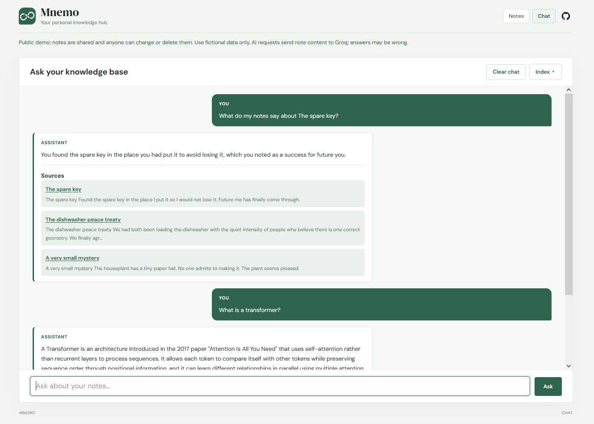
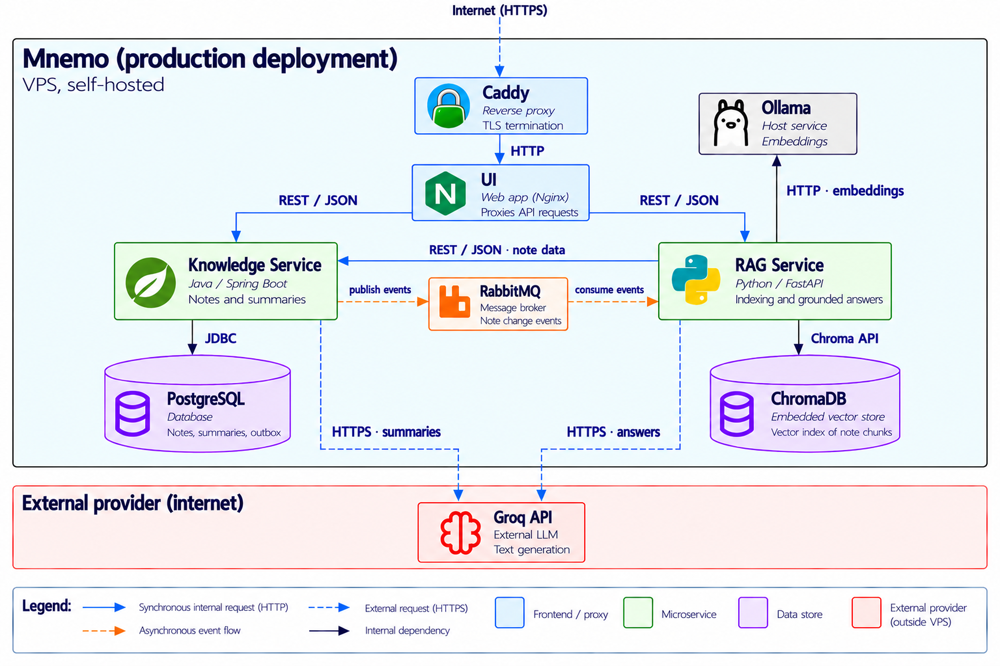

# Mnemo

**A self-hosted knowledge hub for notes, on-demand summaries, and grounded AI answers.**

Mnemo is a full-stack portfolio project built as three independently deployable
services. Ask questions in natural language and get answers grounded in your
notes, with links back to the source material.

**[Open the live demo](https://mnemo-hub.duckdns.org)** · Shared and anonymous:
anyone can change or delete notes. Use fictional data only; AI requests send
note content to Groq, and generated answers may be wrong.

## See it in action

<p align="center">
  
  
</p>

## System architecture



The React UI connects to the Java Knowledge service and Python RAG service
through a same-origin HTTPS proxy. Knowledge service is the source of truth for
notes and summaries in PostgreSQL. It publishes note-change events through
RabbitMQ; RAG service keeps a derived ChromaDB index current, retrieves relevant
note chunks, and generates answers with source references. Ollama creates
embeddings; Groq generates summaries and answers in the public deployment.

## What this project demonstrates

- **Full-stack, polyglot development:** React/TypeScript, Java/Spring Boot, and
  Python/FastAPI working as separate services.
- **Reliable asynchronous integration:** database-backed transactional outbox,
  at-least-once RabbitMQ delivery, idempotent consumers, dead-letter handling,
  and reconciliation for recovery.
- **Grounded RAG:** versioned note indexing, semantic retrieval, and answers
  linked to their source notes.
- **Production-minded delivery:** containerized services, automated CI/CD, and
  a live HTTPS deployment with private backend services and bounded requests.

## Key design decisions

- **One source of truth:** PostgreSQL owns notes and summaries; ChromaDB is
  derived, rebuildable index data. RAG detects stale content using note hashes
  and indexing-configuration versions.
- **Events trigger current-state reads:** RabbitMQ messages identify changed
  notes; RAG fetches their latest state from Knowledge service. Duplicate and
  out-of-order events therefore converge safely.
- **Durability without a separate platform:** note changes and outbox events
  commit together. Failed delivery retries, while reconciliation provides a
  recovery path for index drift.
- **Separate embeddings and generation:** embeddings stay on Ollama while
  answer-generation providers can change without reindexing.

## Technology stack

| Area | Technologies |
| --- | --- |
| Frontend | React, TypeScript, Vite |
| Knowledge API | Java 25, Spring Boot 4, Spring Data JPA, Flyway |
| RAG API | Python 3.12+, FastAPI, ChromaDB, tokenizers |
| Data and messaging | PostgreSQL, RabbitMQ |
| AI | Ollama embeddings and local models; Groq generation in the public demo |
| Delivery | Docker Compose, Nginx, Caddy, GitHub Actions |

## Production scope

- Public demo APIs are intentionally anonymous and shared.
- Database reset is the only authenticated operation.
- Notes + summaries are primary data; the vector index is derived and rebuildable.
- The demo is optimized for clarity and reliability, not multi-user tenancy.

## Service documentation

- [Knowledge service](knowledge-service/README.md)
- [RAG service](rag-service/README.md)
- [UI](ui/README.md)
- [Deployment and operations](deploy/README.md)

## Run locally

Prerequisites: Docker Compose and [Ollama](https://ollama.com). Pull the local
models, then start the full application from the repository root:

```sh
ollama pull qwen3-embedding:0.6b
ollama pull qwen3:4b
docker compose up -d --build
```

Open **http://localhost:5173**. Compose starts the UI, both APIs, PostgreSQL,
RabbitMQ, and starter data; Ollama runs on the host. See the
[deployment guide](deploy/README.md) for public hosting and operations.

## Testing

The CI workflow builds and tests the services and runs isolated cross-service
integration checks without downloading real AI models. Run the end-to-end
integration scenario locally with Docker Compose and Python 3.12+:

```sh
python tests/e2e/run.py
```

See the [RAG sanity-check results](evaluation/results.md) for the small,
real-model evaluation and its limitations.
